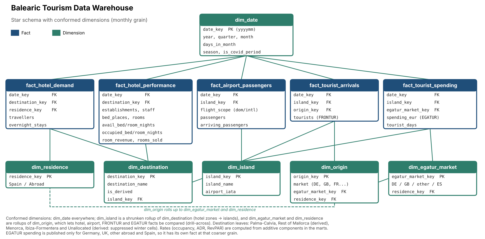
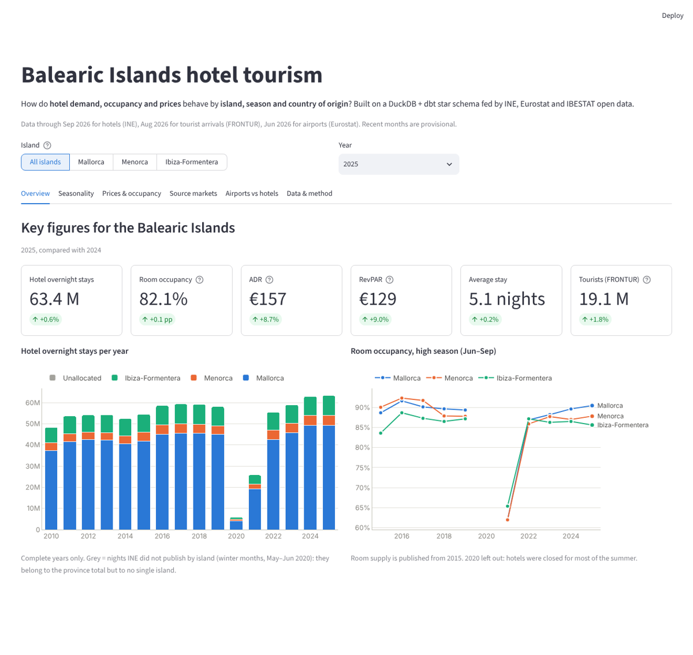
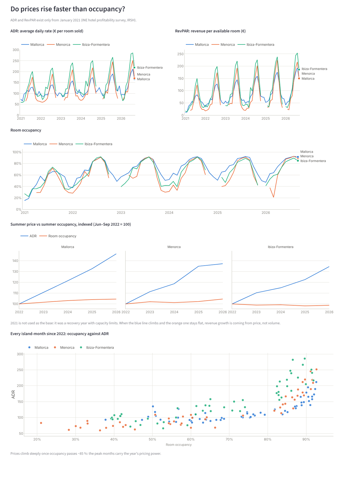
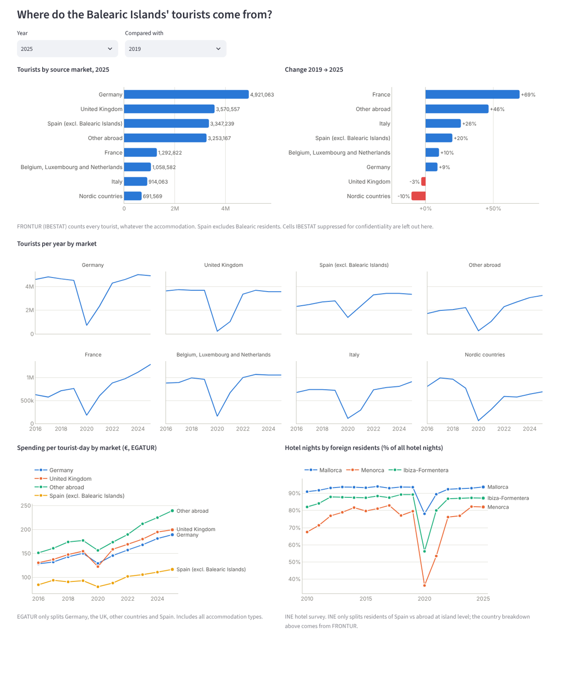

# Balearic Tourism Data Warehouse


<!-- Live demo: add the Streamlit Community Cloud URL here once deployed -->

**Business question:** how do hotel demand, occupancy and prices behave in the
Balearic Islands by island, season and the tourist's country of origin?

A star-schema data warehouse built on public data (INE hotel occupancy and
profitability surveys, airport traffic, IBESTAT tourist arrivals and spending), modelled with **DuckDB + dbt** and
explored in a **Streamlit** dashboard.



## Questions the dashboard answers

- **Seasonality:** how much more seasonal is Ibiza than Mallorca or Menorca?
- **Source markets:** which countries grow or shrink (Germany, UK, Italy...)?
- **Price vs occupancy:** do prices (ADR, RevPAR) rise faster than occupancy?
- **Airports vs hotels:** how many arriving passengers end up in hotels?

## The dashboard

A six-tab Streamlit app on top of the warehouse marts: overview KPIs, seasonality,
prices vs occupancy, source markets, airports vs hotels, and a data/method tab with
a downloadable KPI table. One island filter and one year filter drive every tab;
charts follow the viewer's light or dark theme.



<details>
<summary>More screenshots</summary>




</details>

What the data says so far (2025 unless stated):

- **Price, not volume, drives growth.** June-September ADR rose 23-35 % between 2022
  and 2025 (Menorca +35 %, Mallorca +33 %, Ibiza +23 %) while summer room occupancy
  moved by less than 5 % either way; it was already 86-90 %.
- **Seasonality:** Menorca (77 % of hotel nights in June-September) and Ibiza (73 %)
  are far more seasonal than Mallorca (64 %), and all three are slowly stretching
  their season into spring and autumn.
- **Source markets:** Germany (4.9 M tourists) and the UK (3.6 M) still lead, but the
  UK is 3 % below 2019 while France (+69 %) and Italy (+26 %) grew fastest.

## Data sources

See [docs/data_sources.md](docs/data_sources.md) for the granularity of each
source and how it shaped the model.

## How to run

Requires Python 3.11+. Everything runs locally; the warehouse is a single DuckDB file.

```bash
pip install -r requirements.txt

# 1. Extract (optional: data/raw/ is already committed)
python -m etl.download_ine        # INE hotel tables -> data/raw/ine/
python -m etl.download_airports   # monthly airport passengers -> data/raw/airports/
python -m etl.download_ibestat    # FRONTUR / EGATUR by island and market -> data/raw/ibestat/

# 2. Load the raw files into DuckDB (schema `raw`)
python -m etl.load_raw            # -> data/balearic_tourism.duckdb

# 3. Transform and test with dbt (profiles.yml in the repo root is picked up automatically)
dbt build                         # 5 seeds, 25 models, 124 tests
dbt docs generate && dbt docs serve   # optional: lineage graph and column docs
```

Set `DUCKDB_PATH` to write the warehouse somewhere else.

### Run the dashboard

```bash
# 4. Export the tables the dashboard reads (core + analytics schemas) to Parquet
python dashboard/export_data.py   # -> dashboard/data/*.parquet (~120 KB, committed)

# 5. Start the app
streamlit run dashboard/app.py    # http://localhost:8501
```

The warehouse file itself is not committed (`*.duckdb` is git-ignored), so the app
reads the small Parquet snapshot in `dashboard/data/`. That also means the dashboard
runs on its own: `pip install -r dashboard/requirements.txt` and step 5 are enough.

### Deploy to Streamlit Community Cloud

1. Push the repository to GitHub (with `dashboard/data/*.parquet` included).
2. On [share.streamlit.io](https://share.streamlit.io), choose **Create app**, pick the
   repository and branch, and set the main file path to `dashboard/app.py`.
3. Deploy. Community Cloud installs `dashboard/requirements.txt` (the file next to the
   entry point, which only lists the app's dependencies) and picks up `.streamlit/config.toml`.

To refresh the published numbers, rerun steps 1-4 and push the new Parquet files.

## The warehouse

Built with dbt in four layers, each in its own DuckDB schema:

| Layer | Schema | What it does |
|---|---|---|
| Seeds | `reference` | Hand-written dimension members and source code mappings (`seeds/*.csv`) |
| Staging | `staging` | One view per source table: Spanish labels to codes, wide measures, units fixed |
| Intermediate | `intermediate` | Derived leaves (*Rest of Mallorca*, *Unallocated*), additive hotel components, residual markets |
| Core | `core` | Star schema: 6 dimensions and 5 facts (tables) |
| Analytics | `analytics` | `mart_hotel_kpis` (occupancy, ADR, RevPAR by destination) and `mart_island_monthly` (drill-across) |

**Facts** (all monthly):

| Fact | Grain | Measures |
|---|---|---|
| `fact_hotel_demand` | destination x residence | travellers, overnight stays |
| `fact_hotel_performance` | destination | establishments, bed places, rooms, staff, available / occupied bed- and room-nights, room revenue, rooms sold |
| `fact_airport_passengers` | island x flight scope | passengers, arriving passengers |
| `fact_tourist_arrivals` | island x source market | tourists (FRONTUR) |
| `fact_tourist_spending` | island x EGATUR market | spending, tourist days (EGATUR) |

**Modelling choices worth knowing** (details in [docs/data_sources.md](docs/data_sources.md)):

- INE's *Isla de Mallorca* contains *Palma - Calvià*, so the model stores
  Palma - Calvià and a derived *Rest of Mallorca*; the destination leaves add
  up to the Balearic total.
- When INE suppresses an island (winter months, May-June 2020), the gap to the
  province total goes to an *Unallocated* destination instead of disappearing.
- Occupancy, ADR and RevPAR are not additive. The facts store the quantities
  behind them (room-nights, revenue, rooms sold) and the marts divide sums, so
  rates are correct at any level of aggregation, including Rest of Mallorca.
- ADR and RevPAR exist only from January 2021 (INE IRSH survey); rooms from 2015.

**Tests** (124 in total): keys are unique and not null, every fact key exists
in its dimension, measures are non-negative and rates lie in [0, 1], plus five
reconciliation tests in [`tests/`](tests/):

- hotel destination leaves add up to the INE province total (±3 rounding);
- domestic + international airport passengers equal Eurostat's total;
- FRONTUR markets add up to each island's total;
- tourist days derived from EGATUR spending match EGATUR's published nights (1 %);
- rooms sold (IRSH) and occupied rooms (EOH), two surveys measuring the same
  thing, agree within 5 points of occupancy in the high season.

Example query:

```sql
-- Share of 2025 hotel nights spent in June-September, by island
select island_name,
       sum(hotel_overnight_stays) filter (where season = 'High')
         / sum(hotel_overnight_stays) as high_season_share
from analytics.mart_island_monthly
where year = 2025 and island_name <> 'Unallocated'
group by island_name;
-- Menorca 77 %, Ibiza-Formentera 73 %, Mallorca 64 %
-- (Menorca and Ibiza winter months suppressed by INE sit in Unallocated,
--  so their shares are slight overestimates)
```

## Repository layout

```
balearic-tourism-dw/
├── data/raw/        # downloaded source files (reproducible via etl/)
├── etl/             # download and load into DuckDB (Python)
├── models/          # dbt models: staging, intermediate, marts/core, marts/analytics
├── seeds/           # dimension members and source code mappings
├── tests/           # dbt reconciliation tests
├── macros/          # generic tests and helpers
├── dbt_project.yml, profiles.yml
├── dashboard/       # Streamlit app: app.py, charts.py, data.py, export_data.py, data/*.parquet
├── docs/            # schema diagram and source notes
└── notebooks/       # exploration
```

## License

Code is released under the [MIT License](LICENSE). Source data belongs to INE,
IBESTAT and Eurostat, redistributed with attribution under their open-data reuse terms.
